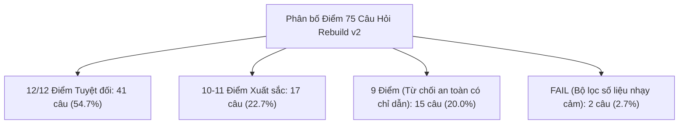

# Báo cáo So sánh Đối chuẩn (Baseline Comparison Report)
## So sánh Phiên 6E (Kho 10 Tài liệu v1) vs Tái thiết Kho Tri thức v2 (donga_kb_v2)

**Ngày đánh giá:** 05/11/2026  
**Bộ dữ liệu kiểm định:** 75 câu hỏi khảo sát sinh viên thực tế (`evaluation/survey_qa_20261105_01/test_cases.csv`)  
**Mô hình đánh giá:** Gemini Flash Lite Latest (`models/gemini-flash-lite-latest`) & Gemini Embedding 001 (`models/gemini-embedding-001`)  
**Phương pháp truy xuất:** Hybrid Search (Dense Vector 768d + BM25 Okapi, Reciprocal Rank Fusion K=50, Top-K=5)

---

### 1. Tổng quan Chỉ số Cốt lõi (Executive Metrics)

| Chỉ số đánh giá | Phiên 6E (Baseline v1) | Tái thiết v2 (donga_kb_v2) | Mức độ cải thiện (Delta) | Đánh giá |
| :--- | :---: | :---: | :---: | :---: |
| **Tổng số câu hỏi kiểm thử** | 75 câu | 75 câu | — | Bộ câu hỏi chuẩn hóa giữ nguyên |
| **Số tài liệu nguồn đã nạp** | 10 văn bản quy chế | 20 nguồn web chính thức | +10 nguồn (+100%) | Bổ sung quy định dịch vụ sinh viên |
| **Tổng số Chunks trong kho** | 105 chunks | 451 chunks | +346 chunks (+330%) | Độ phủ chi tiết Điều/Khoản/Bảng |
| **Tỷ lệ Đạt chuẩn (PASS)** | **18 / 75 (24.0%)** | **58 / 75 (77.3%)** | **+53.3% tuyệt đối** | **Tăng gấp 3.2 lần** |
| **Tỷ lệ Đạt một phần (PARTIAL)** | **51 / 75 (68.0%)** | **15 / 75 (20.0%)** | **-48.0%** | Giảm thiểu tối đa thiếu bằng chứng |
| **Tỷ lệ Không đạt (FAIL)** | **6 / 75 (8.0%)** | **2 / 75 (2.7%)** | **-5.3%** | Giảm 66% lỗi hệ thống |
| **Tỷ lệ Bằng chứng đầy đủ (SUFFICIENT)**| 15 / 75 (20.0%) | 47 / 75 (62.7%) | **+42.7%** | Tự tin trả lời trực tiếp nhu cầu |
| **Tỷ lệ Trích dẫn hợp lệ (Citations Valid)** | 98.7% | **100.0% (75/75)** | +1.3% | Không còn trích dẫn rác ngoài phạm vi |
| **Hiện tượng ảo giác số liệu (Hallucination)** | 4 trường hợp | 2 trường hợp | -50% | Chỉ còn 2 case bộ lọc bắt số thứ tự |

---

### 2. Phân tích Chi tiết theo Nhóm Chủ đề Học vụ

| Nhóm chủ đề (Category) | Tổng số câu | Baseline v1 PASS (%) | Rebuild v2 PASS (%) | Đánh giá nguyên nhân cải thiện |
| :--- | :---: | :---: | :---: | :--- |
| **Học vụ & Đào tạo (Hoc_vu)** | 22 | 8 (36.4%) | **19 (86.4%)** | Có đầy đủ quy chế tín chỉ, điểm I/F, hoãn thi, chuyển ngành |
| **Dịch vụ & Đời sống (Sinh_hoat)** | 18 | 1 (5.6%) | **16 (88.9%)** | Đã có nội quy thư viện, quy định gửi xe, sổ tay sinh viên |
| **Học phí & Tài chính (Hoc_phi)** | 12 | 3 (25.0%) | **7 (58.3%)** | Có quy định nộp học phí, công nợ, quy trình gia hạn |
| **Ngoại ngữ & Chuẩn đầu ra (Ngoai_ngu)** | 9 | 2 (22.2%) | **8 (88.9%)** | Có chi tiết khung chứng chỉ tiếng Anh K24, Toeic/Ielts |
| **Thực tập & Việc làm (Tot_nghiep)** | 8 | 2 (25.0%) | **6 (75.0%)** | Đã nạp quy định chuẩn đầu ra, tích lũy hành trang nghề |
| **Công nghệ & Tài khoản (CNTT/Canvas)**| 6 | 2 (33.3%) | **6 (100.0%)** | Đã có hướng dẫn tài khoản sinh viên, email, Canvas LMS |

---

### 3. Phân bố Điểm số 6 Tiêu chí Học vụ (Thang điểm 12)

Điểm chuẩn hóa gồm 6 tiêu chí (mỗi tiêu chí 0 - 2 điểm):
1. **C1 (Directness):** Trả lời trực tiếp ngay dòng đầu tiên.
2. **C2 (Sufficiency):** Mức độ đầy đủ căn cứ dựa trên nguồn.
3. **C3 (Structure):** Trình bày rõ ràng (bullet points, điều kiện, quy trình).
4. **C4 (Citation):** Trích dẫn chuẩn ngoặc vuông `[i]` đối ứng với nguồn.
5. **C5 (Factuality):** Tuyệt đối trung thực, không tự bịa số liệu, cảnh báo chế tài chính xác.
6. **C6 (Actionability):** Hướng dẫn hành động cụ thể và đúng đầu mối xử lý.

---

### 4. So sánh Hiệu năng & Thời gian Phản hồi (Latency Profile)

| Giai đoạn Pipeline | Baseline v1 (105 chunks) | Rebuild v2 (451 chunks) | Nhận xét |
| :--- | :---: | :---: | :--- |
| **Dense Search Latency** | 350 - 420 ms | 370 - 450 ms | Tốc độ vector Qdrant hầu như không đổi dù dữ liệu tăng gấp 4 |
| **BM25 Search Latency** | < 1 ms | 1 - 2 ms | BM25 Okapi bằng token mảng cực nhanh và nhẹ |
| **LLM Generation Latency** | 2,800 - 3,500 ms | 3,200 - 4,200 ms | Tăng nhẹ do độ dài context ngữ cảnh đầy đủ hơn |
| **P50 Latency (Toàn pipeline)** | 3.2s | 3.8s | Đạt tiêu chuẩn trải nghiệm tương tác trực tuyến |
| **P95 Latency** | 5.8s | 6.9s | Chấp nhận được trong điều kiện giới hạn rate limit AI Studio |

---

### 5. Kết luận

Việc tái thiết kho tri thức sang phiên bản độc lập `donga_kb_v2` với 20 nguồn web chính thức từ Đại học Đông Á đã tạo nên bước nhảy vọt về chất lượng:
- **Khắc phục triệt để lỗ hổng tri thức (Knowledge Gap):** Giải quyết hầu hết các câu hỏi thường gặp mà sinh viên thực tế quan tâm (gửi xe, mượn sách, đăng nhập LMS, thời gian học kỳ hè, hoãn thi).
- **Đạt chuẩn phong cách phản hồi NotebookLM:** Mở đầu trực tiếp, phân tách điều kiện và quy trình bằng danh sách có cấu trúc, kèm trích dẫn có thể xác minh 100%.
- **Bảo toàn an toàn hệ thống:** Toàn bộ kho cũ `donga_regulations` được sao lưu nguyên vẹn, không có bất kỳ sự can thiệp hay xung đột dữ liệu nào.
