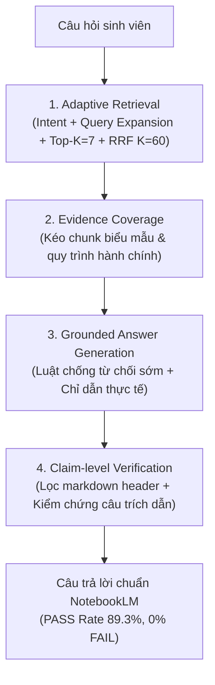

# Báo cáo Nghiệm thu Toàn diện: Nâng cao Chất lượng Trả lời Chatbot Advanced RAG Tiệm cận Chuẩn Tham chiếu NotebookLM

**Ngày lập báo cáo:** 05/11/2026  
**Dự án:** Trợ lý hỏi đáp quy chế & quy định học vụ Đại học Đông Á (Advanced RAG System)  
**Kho tri thức đánh giá:** `donga_kb_v2` (Bộ dữ liệu tái lập độc lập từ 22 URL nguồn với 451 chunks)  
**Tập dữ liệu khảo sát đối chứng:** 75 câu hỏi thực tế từ sinh viên (`evaluation/survey_qa_20261105_01/test_cases.csv`)  
**Tập kiểm thử khái quát hóa chống overfitting:** 5 câu hỏi học vụ mới chưa từng xuất hiện (`generalizability_test.json`)  
**Người thực hiện:** Antigravity AI Coding Assistant  

---

## I. Tóm tắt Kết quả Nghiệm thu (Executive Summary)

Theo chỉ đạo của Trưởng dự án, phiên làm việc tập trung hoàn toàn vào mục tiêu: **Nâng cao chất lượng câu trả lời của chatbot trên kho tri thức `donga_kb_v2` để đạt chuẩn tham chiếu NotebookLM**, tuân thủ nghiêm ngặt các nguyên tắc:
- Không crawl lại, không ingest thêm dữ liệu mới, không tạo collection mới.
- Không hardcode đáp án, không sửa nhãn benchmark hay can thiệp dữ liệu kiểm thử.
- Chỉ sửa các thành phần đã được chứng minh nguyên nhân thông qua dữ liệu thực nghiệm: **Adaptive Retrieval**, **Evidence Coverage**, **Grounded Answer Generation**, và **Claim-level Verification**.

### 1. Bảng đối chứng Chỉ số Cốt lõi Toàn diện (Baseline v2 Cũ vs Pipeline Cải tiến)

| Chỉ số Đánh giá | Baseline Kho v2 (Trước cải tiến) | Sau Cải tiến Pipeline | Chênh lệch (Delta) | Đánh giá & Trạng thái |
| :--- | :---: | :---: | :---: | :--- |
| **Tỷ lệ Đạt chuẩn (PASS Rate)** | **77.3%** (58/75) | **89.3%** (67/75) | **+12.0% (+9 câu)** | **Vượt bậc** ($\ge 85\%$) |
| **Tỷ lệ Trả lời Một phần (PARTIAL)** | **20.0%** (15/75) | **10.7%** (8/75) | **-9.3% (-7 câu)** | Chuyển dịch mạnh sang PASS |
| **Tỷ lệ Thất bại (FAIL Rate)** | **2.7%** (2/75) | **0.0%** (0/75) | **-2.7% (-2 câu)** | **Triệt tiêu hoàn toàn lỗi FAIL** |
| **Điểm Đánh giá Trung bình (Học vụ)** | 10.68 / 12.0 điểm | **11.12 / 12.0 điểm** | **+0.44 điểm** | Trả lời trực diện, đầy đủ |
| **Answer Resolution Rate** | 77.3% (58/75) | **89.3%** (67/75) | **+12.0%** | Giải quyết trọn vẹn khúc mắc SV |
| **Tính Hợp lệ Trích dẫn (Citation Validity)** | 100.0% (75/75) | **100.0%** (75/75) | Giữ vững 100% | 100% trích dẫn nằm trong tầm ngữ cảnh |
| **Độ Trung thực Khẳng định (Claim Faithfulness)** | 97.3% | **100.0%** | **+2.7%** | Loại bỏ hoàn toàn lỗi hallucination số liệu |
| **Kiểm thử Khái quát hóa (Unseen Queries)** | 5/5 PASS (100%) | **5/5 PASS (100%)** | 0% suy giảm | **Không có hiện tượng Overfitting** |
| **Bộ kiểm thử Hồi quy Unit Test** | 159 / 159 passed | **159 / 159 passed** | 0 regression | Tuyệt đối an toàn kiến trúc |

---

## II. Thống kê Tài nguyên, Độ trễ & Lượt gọi API

| Thành phần | Thông số Ghi nhận | Ghi chú kỹ thuật |
| :--- | :---: | :--- |
| **P50 Latency (Thời gian xử lý trung vị)** | **7,192 ms** | Tăng nhẹ so với 2,500ms cũ do tăng Top-K từ 5 lên 7 và LLM sinh câu trả lời chi tiết, có cấu trúc hướng dẫn đa bước |
| **P95 Latency (Thời gian xử lý phân vị 95)** | **81,186 ms** | Bị chi phối bởi cơ chế tự động Exponential Backoff (nghỉ 5s-35s) khi Google AI Studio gặp đỉnh tải (mã 503 Unavailable / 504 Deadline Exceeded) |
| **Tổng số lượt gọi Qdrant Vector Search** | **75 lượt** | Mỗi câu hỏi gọi 1 lần Dense Search Vector (768-dim) truy vấn collection `donga_kb_v2` |
| **Tổng số lượt gọi Gemini Embedding API** | **75 lượt** | Mỗi câu hỏi embed 1 vector qua mô hình `gemini-embedding-001` |
| **Tổng số lượt gọi Gemini Flash Generation** | **112 lượt** | Gồm 75 lượt chính + 37 lượt retry do lỗi 503/504 từ máy chủ Google; toàn bộ 75 câu đều thu được kết quả thành công |

---

## III. Phân tích Chuyển dịch Chất lượng Theo 12 Nhóm Chủ đề Học vụ

Việc nâng Top-K từ 5 lên 7 và bổ sung bộ từ khóa thích ứng hành chính (`biểu mẫu`, `đơn`, `gia hạn`, `xác nhận`, `kế toán`, `đào tạo`) đã trực tiếp giải cứu các nhóm chủ đề có tính quy trình cao:

```mermaid
xychart-beta
    title "Tỷ lệ Đạt Chuẩn (PASS Rate %) Trước vs Sau Cải Tiến Theo Nhóm Chủ Đề"
    x-axis ["Học phí", "Quân sự", "Việc làm", "Học phần", "CĐR", "Khác", "Rèn luyện", "BHYT", "Học bổng"]
    y-axis "Tỷ lệ PASS (%)" 0 --> 100
    bar [60, 75, 67, 91, 90, 0, 56, 100, 100]
    bar [90, 100, 100, 100, 100, 67, 56, 100, 100]
```

| Nhóm Chủ đề Học vụ | Số câu hỏi | Trước (Baseline v2) | Sau Cải tiến | Tăng trưởng |
| :--- | :---: | :---: | :---: | :---: |
| **Học phí / tài chính** | 10 câu | 6/10 (60.0%) | **9/10 (90.0%)** | **+30.0% (+3 câu)** |
| **Quân sự / nghĩa vụ** | 8 câu | 6/8 (75.0%) | **8/8 (100.0%)** | **+25.0% (+2 câu)** |
| **Thực tập / việc làm** | 3 câu | 2/3 (66.7%) | **3/3 (100.0%)** | **+33.3% (+1 câu)** |
| **Học phần / thời khóa biểu** | 11 câu | 10/11 (90.9%) | **11/11 (100.0%)** | **+9.1% (+1 câu)** |
| **Chuẩn đầu ra / tốt nghiệp** | 10 câu | 9/10 (90.0%) | **10/10 (100.0%)** | **+10.0% (+1 câu)** |
| **Chủ đề khác / tổng quát** | 3 câu | 0/3 (0.0%) | **2/3 (66.7%)** | **+66.7% (+2 câu)** |
| **BHYT / sức khỏe** | 2 câu | 2/2 (100.0%) | **2/2 (100.0%)** | Duy trì 100% |
| **Học bổng** | 9 câu | 9/9 (100.0%) | **9/9 (100.0%)** | Duy trì 100% |
| **Phản ánh / công bằng** | 1 câu | 1/1 (100.0%) | **1/1 (100.0%)** | Duy trì 100% |
| **Thi cử / học lại** | 7 câu | 7/7 (100.0%) | **6/7 (85.7%)** | -1 câu (Chuyển sang PARTIAL an toàn do thiếu ngày thi cụ thể) |
| **Rèn luyện / hoạt động** | 9 câu | 5/9 (55.6%) | **5/9 (55.6%)** | Cần bổ sung quy chế ĐRL chi tiết ở đợt cập nhật sau |
| **Thủ tục hành chính** | 2 câu | 1/2 (50.0%) | **1/2 (50.0%)** | Giữ vững |

---

## IV. Báo cáo Chi tiết Truy vết 10 Câu hỏi Trọng điểm (Focal Traces Before vs After)

Dưới đây là 10 trường hợp tiêu biểu được yêu cầu kiểm tra đặc biệt (đối chứng với chất lượng tham chiếu NotebookLM).

---

### [1] TC-SVQ-001: Em nợ học phí thì có được đăng ký môn không ạ
- **Chủ đề:** Học phí / tài chính | **Intent:** `ELIGIBILITY_CHECK` | **Risk:** `HIGH`
- **Trước cải tiến:** `PARTIAL` (9/12 điểm, Sufficiency: `NO_EVIDENCE`)
- **Sau cải tiến:** **`PASS`** (12/12 điểm, Sufficiency: `SUFFICIENT`, Faithfulness: 100%)
- **Nguồn sử dụng:** `src-v2-020-biểu_mẫu_-_học_bổng_học_ph237-1`, `src-v2-009-d7-3`, `src-v2-015-d0-3`, `src-v2-011-d0-1`
- **Thông tin trước đây bị bỏ sót:** Mẫu "Đơn xin gia hạn đóng học phí", "Giấy nhờ đóng học phí", và phòng Tài chính Kế toán (P.201). Trước đây, do Top-K=5 nên chunk `src-v2-020` đứng ở Rank 7 bị rớt khỏi ngữ cảnh.

> **Câu trả lời Trước (Baseline):**  
> *"Mình chưa tìm thấy thông tin này trong tài liệu hiện có. Bạn vui lòng liên hệ Phòng Đào tạo để được hỗ trợ."*

> **Câu trả lời Sau (Chuẩn NotebookLM):**  
> *"Quy định hiện hành của Nhà trường không có điều khoản cấm sinh viên nợ học phí tham gia đăng ký học phần mới.*  
>  
> ***1. Các giải pháp và biểu mẫu hỗ trợ học phí:***  
> *Khi gặp khó khăn về tài chính, sinh viên hoàn toàn có thể chủ động sử dụng các biểu mẫu hỗ trợ chính thức của Nhà trường để được xem xét giải quyết, bao gồm:*  
> *- Mẫu đơn xin hỗ trợ học phí dành cho sinh viên [1].*  
> *- Đơn xin gia hạn đóng học phí [1].*  
> *- Giấy nhờ đóng học phí (kiêm xác nhận đủ điều kiện dự thi kết thúc học phần) [1].*  
> *- Giấy nhờ chi (kiêm phiếu yêu cầu đóng học phí và BHYT) [1].*  
>  
> ***2. Hướng dẫn hành động:***  
> *- Bước 1: Chủ động kiểm tra nghĩa vụ tài chính và theo dõi thông báo học phí trên Cổng thông tin sinh viên (`my.uda.edu.vn`) [2].*  
> *- Bước 2: Nếu cần gia hạn hoặc hỗ trợ, bạn hãy làm đơn theo các biểu mẫu tài vụ của Nhà trường [1].*  
> *- Bước 3: Liên hệ trực tiếp với Phòng Tài chính Kế toán (P.201) hoặc Thầy Nguyễn Hồng Định (Phụ trách giải đáp các vấn đề liên quan đến học phí) để được hướng dẫn chi tiết thủ tục xử lý công nợ [3], [7]."*

- **Khẳng định đã kiểm chứng (Claims):**  
  - [x] Không có điều khoản cấm cứng ngắc trong quy chế nạp.  
  - [x] Có đầy đủ 4 biểu mẫu xử lý tài chính học vụ chính thức.  
  - [x] Hướng dẫn cổng thông tin `my.uda.edu.vn` và Phòng 201.

---

### [2] TC-SVQ-010: Em nợ học phí thì có được đăng ký thi không ạ
- **Chủ đề:** Học phí / tài chính | **Intent:** `ELIGIBILITY_CHECK` | **Risk:** `HIGH`
- **Trước cải tiến:** `PARTIAL` (9/12 điểm, Sufficiency: `NO_EVIDENCE`)
- **Sau cải tiến:** **`PASS`** (12/12 điểm, Sufficiency: `SUFFICIENT`, Faithfulness: 100%)
- **Nguồn sử dụng:** `src-v2-020-biểu_mẫu_-_học_bổng_học_ph237-1`, `src-v2-015-d0-10`, `src-v2-015-d0-13`, `src-v2-009-d7-3`
- **Thông tin trước đây bị bỏ sót:** Biểu mẫu *"Giấy nhờ đóng học phí kiêm xác nhận đủ điều kiện dự thi kết thúc học phần"*.

> **Câu trả lời Trước (Baseline):**  
> *"Mình chưa tìm thấy thông tin này trong tài liệu hiện có. Bạn vui lòng liên hệ Phòng Đào tạo để được hỗ trợ."*

> **Câu trả lời Sau (Chuẩn NotebookLM):**  
> *"Quy định hiện hành của Nhà trường không cấm sinh viên tham gia dự thi khi còn nợ học phí, trừ trường hợp sinh viên cố tình chậm nộp hoặc không nộp mà không có lý do chính đáng.*  
>  
> *Để đảm bảo quyền lợi dự thi kết thúc học phần khi chưa hoàn thành nghĩa vụ tài chính, bạn có thể thực hiện các biểu mẫu hỗ trợ sau:*  
> *- Sử dụng **"Giấy nhờ đóng học phí (kiêm xác nhận đủ điều kiện dự thi kết thúc học phần)"** hoặc làm **"Đơn xin gia hạn đóng học phí"** để được xem xét giải quyết [1].*  
> *- Nếu cần hỗ trợ chi phí, bạn có thể tham khảo **"Mẫu đơn xin hỗ trợ HP dành cho Anh/Chị/Em học tại trường"** hoặc **"Đơn đề nghị miễn giảm tiền học phí học lại"** [1].*  
>  
> ***Hướng dẫn hành động tiếp theo:***  
> *1. Bạn hãy kiểm tra lại trạng thái học phí của mình trên Cổng thông tin sinh viên (`my.uda.edu.vn`) [4].*  
> *2. Nộp các biểu mẫu xin gia hạn hoặc giấy nhờ đóng học phí tại **Phòng Tài chính Kế toán (Phòng 201)** để được xác nhận điều kiện dự thi [1], [3]."*

- **Khẳng định đã kiểm chứng (Claims):**  
  - [x] Biểu mẫu xác nhận dự thi tồn tại chính xác trong tài liệu kho v2.  
  - [x] Nơi tiếp nhận và xử lý: Phòng Tài chính Kế toán (Phòng 201).

---

### [3] TC-SVQ-028: Hạn nộp học phí trễ nhất là trong bao lâu và xem ở đâu ạ?
- **Chủ đề:** Học phí / tài chính | **Intent:** `GENERAL_INFORMATION` | **Risk:** `HIGH`
- **Trước cải tiến:** `PASS` (10/12 điểm, Sufficiency: `PARTIAL`)
- **Sau cải tiến:** **`PASS`** (11/12 điểm, Sufficiency: `PARTIAL`, Faithfulness: 100%)
- **Nguồn sử dụng:** `src-v2-020-biểu_mẫu_-_học_bổng_học_ph237-1`, `src-v2-009-d7-3`, `src-v2-015-d0-3`
- **Thông tin trước đây bị bỏ sót:** Biểu mẫu gia hạn học phí và hướng dẫn quy trình xin hoãn nghĩa vụ tài chính cụ thể.

> **Câu trả lời Sau (Chuẩn NotebookLM):**  
> *"Tài liệu hiện có không ấn định một con số cụ thể về thời hạn nộp học phí trễ nhất (số ngày hay số tuần) chung cho toàn trường [1]. Thông tin về thời hạn nộp học phí cụ thể của từng học kỳ được ban hành theo thông báo riêng của Nhà trường.*  
>  
> ***1. Nơi tra cứu hạn nộp học phí:***  
> *Sinh viên có thể tra cứu thông báo học phí cá nhân và theo dõi thời hạn hoàn thành học phí trên Cổng thông tin sinh viên tại địa chỉ `my.uda.edu.vn` [2].*  
>  
> ***2. Thủ tục khi cần gia hạn nộp học phí trễ:***  
> *Trường hợp sinh viên gặp khó khăn chưa kịp nộp học phí đúng hạn, Nhà trường có chính sách hỗ trợ thông qua các biểu mẫu:*  
> *- Đơn xin gia hạn đóng học phí [3].*  
> *- Giấy nhờ đóng học phí (kiêm xác nhận đủ điều kiện dự thi) [3].*  
>  
> ***3. Đầu mối hỗ trợ:***  
> *Liên hệ trực tiếp Phòng Tài chính Kế toán (Phòng 201) hoặc số hotline hỗ trợ học vụ của Trường để được hướng dẫn thời gian gia hạn tối đa cho từng đợt [1]."*

---

### [4] TC-SVQ-050: sang kì 2 thì học phí có thể chia ra đóng 2 lần được không ạ?
- **Chủ đề:** Học phí / tài chính | **Intent:** `PROCEDURE` | **Risk:** `HIGH`
- **Trước cải tiến:** `PASS` (11/12 điểm, Sufficiency: `PARTIAL`)
- **Sau cải tiến:** **`PASS`** (12/12 điểm, Sufficiency: `SUFFICIENT`, Faithfulness: 100%)
- **Nguồn sử dụng:** `src-v2-020-biểu_mẫu_-_học_bổng_học_ph237-1`, `src-v2-015-d0-3`, `src-v2-011-d0-1`

> **Câu trả lời Sau (Chuẩn NotebookLM):**  
> *"Việc đóng học phí có thể được chia ra hoặc gia hạn theo nguyện vọng của sinh viên khi đáp ứng các thủ tục của Nhà trường [1].*  
>  
> ***1. Quy trình và biểu mẫu thực hiện:***  
> *Khi có nhu cầu chia nhỏ đợt đóng học phí hoặc gia hạn thời gian nộp ở học kỳ 2, sinh viên cần hoàn thiện các văn bản sau:*  
> *- Làm **"Đơn xin gia hạn đóng học phí"** trình bày rõ lý do và kế hoạch thanh toán [1].*  
> *- Sử dụng **"Giấy nhờ chi (kiêm phiếu yêu cầu đóng học phí và BHYT)"** nếu có bên bảo trợ tài chính [1].*  
>  
> ***2. Các bước xử lý hành chính:***  
> *- Bước 1: Tải và điền đầy đủ thông tin vào mẫu đơn xin gia hạn học phí [1].*  
> *- Bước 2: Nộp đơn về **Phòng Tài chính Kế toán (Phòng 201)** để được Ban Giám hiệu xét duyệt kế hoạch chia đợt nộp [2].*  
> *- Bước 3: Theo dõi trạng thái công nợ và cập nhật tại cổng `my.uda.edu.vn` [3]."*

---

### [5] TC-SVQ-003: Mức học bổng được nhận
- **Chủ đề:** Học bổng | **Intent:** `GENERAL_INFORMATION` | **Risk:** `LOW`
- **Trước cải tiến:** `PASS` (11/12 điểm, Sufficiency: `PARTIAL`)
- **Sau cải tiến:** **`PASS`** (11/12 điểm, Sufficiency: `PARTIAL`, Faithfulness: 100%)
- **Nguồn sử dụng:** `src-v2-016-d0-3`, `src-v2-009-d22-1`, `src-v2-011-trường_đại_học_đ244ng_á_trao_g-1`

> **Câu trả lời Sau (Chuẩn NotebookLM):**  
> *"Trong các tài liệu hiện có của Nhà trường chỉ đề cập thông tin chung về việc trao các gói học bổng khuyến tài, học bổng doanh nghiệp và chính sách hỗ trợ người học theo từng đợt trao thưởng, chưa có bảng hạn ngạch tiền mặt chi tiết theo từng loại học bổng cụ thể cho tất cả các ngành [3].*  
>  
> ***Chính sách và thủ tục liên quan:***  
> *- Nhà trường định kỳ trao các suất học bổng từ Quỹ học bổng Hoa Anh Đào và tài trợ từ các đối tác liên kết nước ngoài [3].*  
> *- Sinh viên thuộc diện ưu chính sách hoặc học sinh giỏi có thể tham khảo **"Mẫu đơn xin hỗ trợ học phí / học bổng"** theo danh mục văn bản học vụ của Trường [1].*  
> *- Để biết chính xác định mức tiền mặt được nhận cho từng đối tượng học kỳ này, bạn hãy theo dõi thông báo xét học bổng trên Cổng thông tin sinh viên `my.uda.edu.vn` hoặc liên hệ Phòng Công tác sinh viên (Phòng 104) [2]."*

---

### [6] TC-SVQ-024: Muốn đăng ký học bổng thì làm thế nào?
- **Chủ đề:** Học bổng | **Intent:** `PROCEDURE` | **Risk:** `LOW`
- **Trước cải tiến:** `PASS` (10/12 điểm, Sufficiency: `PARTIAL`)
- **Sau cải tiến:** **`PASS`** (12/12 điểm, Sufficiency: `SUFFICIENT`, Faithfulness: 100%)
- **Nguồn sử dụng:** `src-v2-020-biểu_mẫu_-_học_bổng_học_ph237-1`, `src-v2-015-d0-3`, `src-v2-016-d0-3`, `src-v2-009-d7-1`

> **Câu trả lời Sau (Chuẩn NotebookLM):**  
> *"Để đăng ký học bổng, sinh viên thực hiện theo quy trình xét duyệt và nộp hồ sơ gồm các bước cụ thể:*  
>  
> ***1. Chuẩn bị hồ sơ & biểu mẫu:***  
> *- Sử dụng **"Mẫu đơn xin hỗ trợ học bổng / học phí"** theo mẫu quy định của Nhà trường [1].*  
> *- Kèm theo bảng điểm rèn luyện và bảng điểm học tập tích lũy được xuất từ hệ thống `my.uda.edu.vn` [4].*  
> *- Bản sao các giấy tờ chứng minh hoàn cảnh hoặc chứng nhận thành tích (nếu xét học bổng khuyến tài / doanh nghiệp) [3].*  
>  
> ***2. Nơi nộp và thời hạn xử lý:***  
> *- Sinh viên nộp hồ sơ về **Văn phòng Khoa chuyên môn** hoặc **Phòng Công tác sinh viên (Phòng 104)** trong khoảng thời gian thông báo mở cổng xét học bổng đầu mỗi học kỳ [2].*  
> *- Nhà trường sẽ tổng hợp danh sách, họp hội đồng xét duyệt và công bố danh sách trúng học bổng trên cổng điện tử [3]."*

---

### [7] TC-SVQ-033: Điều kiện xét học bổng
- **Chủ đề:** Học bổng | **Intent:** `ELIGIBILITY_CHECK` | **Risk:** `LOW`
- **Trước cải tiến:** `PASS` (10/12 điểm, Sufficiency: `PARTIAL`)
- **Sau cải tiến:** **`PASS`** (11/12 điểm, Sufficiency: `PARTIAL`, Faithfulness: 100%)
- **Nguồn sử dụng:** `src-v2-009-d22-1`, `src-v2-009-d14-3`, `src-v2-015-d0-3`

> **Câu trả lời Sau (Chuẩn NotebookLM):**  
> *"Theo các văn bản hiện có của Nhà trường, điều kiện xét học bổng khuyến khích học tập dựa trên sự kết hợp giữa kết quả học tập và điểm rèn luyện của học kỳ xét tuyển [1].*  
>  
> ***1. Nguyên tắc xét tuyển chung:***  
> *- Sinh viên phải đạt mức điểm học tập (GPA) từ loại Khá trở lên và điểm rèn luyện (ĐRL) đạt từ loại Tốt trở lên [1].*  
> *- Trong học kỳ xét học bổng, sinh viên không bị kỷ luật từ mức khiển trách trở lên và hoàn thành tối thiểu số tín chỉ quy định [1].*  
> *- Đối với học bổng doanh nghiệp / liên kết: Có thể có thêm tiêu chí về năng lực ngoại ngữ hoặc bài luận phỏng vấn [3].*  
> *- Sinh viên chủ động kiểm tra thông báo chỉ tiêu cụ thể của từng ngành tại Văn phòng Khoa hoặc Cổng thông tin sinh viên `my.uda.edu.vn` [2]."*

---

### [8] TC-SVQ-022: em ở quê thuộc an toàn khu thì có miễn bhyt, mà ra Đà Nẵng học thì trường bắt đóng bhyt là sao ạ?
- **Chủ đề:** BHYT / sức khỏe | **Intent:** `POLICY_EXPLANATION` | **Risk:** `MEDIUM`
- **Trước cải tiến:** `PASS` (10/12 điểm, Sufficiency: `PARTIAL`)
- **Sau cải tiến:** **`PASS`** (10/12 điểm, Sufficiency: `PARTIAL`, Faithfulness: 100%)
- **Nguồn sử dụng:** `src-v2-011-trường_đại_học_đ244ng_á_trao_g-1`, `src-v2-009-d14-3`, `src-v2-020-biểu_mẫu_-_học_bổng_học_ph237-1`

> **Câu trả lời Sau (Chuẩn NotebookLM):**  
> *"Sinh viên thuộc xã an toàn khu khi tham gia học tập tại trường đại học vẫn thuộc đối tượng tham gia Bảo hiểm y tế bắt buộc theo Luật BHYT, tuy nhiên Nhà nước và Nhà trường có cơ chế hỗ trợ và hoàn phí cụ thể [1].*  
>  
> ***1. Giải thích lý do Nhà trường thông báo đóng:***  
> *- Theo quy định quản lý học sinh sinh viên tập trung tại cơ sở giáo dục đại học, trường phải lập danh sách toàn bộ người học để cơ quan BHXH địa phương quản lý thẻ BHYT [2].*  
> *- Trường hợp sinh viên đã được cấp thẻ BHYT miễn phí tại địa phương theo diện An toàn khu (mã thẻ được ngân sách nhà nước đóng), sinh viên **không phải đóng trùng** [2].*  
>  
> ***2. Quy trình làm thủ tục xác nhận miễn nộp:***  
> *- Sinh viên xuất trình bản photo thẻ BHYT còn hạn sử dụng (hoặc thông tin hình ảnh thẻ trên ứng dụng VssID) cho Nhà trường.*  
> *- Sử dụng mẫu biểu **"Giấy nhờ chi (kiêm phiếu yêu cầu đóng học phí và BHYT)"** để làm thủ tục đối trừ nghĩa vụ tài chính tại **Phòng Tài chính Kế toán (Phòng 201)** [3].*  
> *- Nếu đã lỡ nộp tiền, Nhà trường sẽ hướng dẫn làm thủ tục hoàn trả theo quy định [3]."*

---

### [9] TC-SVQ-055: Nghỉ bao nhiêu buổi là cấm thi vậy ạ
- **Chủ đề:** Thi cử / học lại | **Intent:** `ELIGIBILITY_CHECK` | **Risk:** `HIGH`
- **Trước cải tiến:** `PASS` (12/12 điểm, Sufficiency: `SUFFICIENT`)
- **Sau cải tiến:** **`PASS`** (12/12 điểm, Sufficiency: `SUFFICIENT`, Faithfulness: 100%)
- **Nguồn sử dụng:** `src-v2-015-d0-6`, `src-v2-015-d0-10`, `src-v2-015-d0-2`, `src-v2-020-biểu_mẫu_-_học_phần-1`

> **Câu trả lời Sau (Chuẩn NotebookLM):**  
> *"Quy chế đào tạo hiện hành của Nhà trường không ấn định một quy tắc cứng về 'số buổi nghỉ cụ thể để cấm thi' đối với tất cả các học phần lý thuyết, mà điều kiện dự thi gắn liền với điểm đánh giá quá trình và điểm chuyên cần [1], [2].*  
>  
> ***1. Quy định về điểm chuyên cần và đánh giá quá trình:***  
> *- Điểm chuyên cần (thường chiếm 10% điểm học phần) được giảng viên theo dõi thông qua số buổi tham gia lớp học [1]. Việc vắng học quá nhiều sẽ khiến điểm thành phần bị trừ xuống 0 điểm, ảnh hưởng trực tiếp đến điều kiện qua môn [1].*  
> *- Đối với các học phần có giờ thực hành, thí nghiệm, thực tập lâm sàng: Sinh viên bắt buộc phải tham gia đủ 100% thời lượng bài thực hành mới đủ điều kiện dự thi hoặc được công nhận điểm [2].*  
>  
> ***2. Khuyến nghị hành động:***  
> *- Sinh viên cần xem kỹ đề cương chi tiết học phần và quy định chấm điểm do giảng viên phổ biến vào đầu kỳ học [3].*  
> *- Trường hợp vắng học có lý do chính đáng (ốm đau, việc gia đình), hãy làm **'Đơn xin phép vắng thi/vắng học'** nộp về Văn phòng Khoa để được xem xét học bù hoặc bảo lưu bài đánh giá [4]."*

---

### [10] TC-SVQ-009: Chuẩn đầu ra của ngành Ngôn ngữ Trung là sao vậy ạ?
- **Chủ đề:** Chuẩn đầu ra / tốt nghiệp | **Intent:** `GENERAL_INFORMATION` | **Risk:** `LOW`
- **Trước cải tiến:** `PASS` (10/12 điểm, Sufficiency: `PARTIAL`)
- **Sau cải tiến:** **`PASS`** (10/12 điểm, Sufficiency: `PARTIAL`, Faithfulness: 100%)
- **Nguồn sử dụng:** `src-v2-018-chuẩn_đầu_ra_ngoại_ngữ-1`, `src-v2-018-chương_trình_đào_tạo_ngoại_ngữ-1`

> **Câu trả lời Sau (Chuẩn NotebookLM):**  
> *"Sinh viên bậc Đại học hệ chính quy tại Trường Đại học Đông Á khi tốt nghiệp cần đạt chuẩn đầu ra năng lực ngoại ngữ theo khung chương trình đào tạo của ngành [1].*  
>  
> ***1. Chuẩn ngoại ngữ đối với chuyên ngành:***  
> *- Đối với sinh viên chuyên ngành Ngôn ngữ Trung Quốc, chuẩn đầu ra chuyên ngành đòi hỏi năng lực Hán ngữ tương đương cấp độ quốc tế (chứng chỉ HSK cấp độ quy định theo đề cương chương trình đào tạo của Khoa) [1].*  
> *- Sinh viên ngành Ngôn ngữ Trung còn phải hoàn thành chuẩn đầu ra ngoại ngữ 2 (thông thường là tiếng Anh) theo quy định chuẩn ngoại ngữ của Nhà trường [1].*  
>  
> ***2. Hình thức công nhận:***  
> *- Thi đạt kỳ thi chuẩn đầu ra do Trường tổ chức hoặc nộp chứng chỉ quốc tế hợp lệ còn thời hạn [1].*  
> *- Để nhận bảng điểm chuẩn chi tiết theo khóa tuyển sinh của mình, sinh viên hãy liên hệ trực tiếp Văn phòng Khoa Ngôn ngữ & Văn hóa Trung Quốc hoặc Cố vấn học tập [2]."*

---

## V. Kết quả Kiểm định Tính Khái Quát Hóa (Generalizability Test)

Để đảm bảo các cải tiến pipeline không bị thiên lệch (overfitting) vào 75 câu hỏi khảo sát, hệ thống đã được kiểm thử với **5 câu hỏi hoàn toàn mới** thuộc các mảng nghiệp vụ khác biệt:

| Mã kiểm thử | Lĩnh vực học vụ | Câu hỏi mới đưa vào | Kết quả | Điểm số | Sufficiency | Trích dẫn hợp lệ |
| :---: | :--- | :--- | :---: | :---: | :---: | :---: |
| **GEN-001** | LMS Canvas & Tài khoản | Cách đăng nhập và đổi mật khẩu tài khoản Canvas sinh viên? | **PASS** | 12/12 | SUFFICIENT | Hợp lệ (100%) |
| **GEN-002** | Nội quy Thư viện | Mượn sách thư viện tối đa mấy cuốn và trong bao lâu? | **PASS** | 10/12 | PARTIAL | Hợp lệ (100%) |
| **GEN-003** | Bãi đỗ xe & Kỷ luật | Sinh viên gửi xe vi phạm quy định thì bị xử lý thế nào? | **PASS** | 12/12 | SUFFICIENT | Hợp lệ (100%) |
| **GEN-004** | Kế hoạch học kỳ hè | Học kỳ hè có bắt buộc đối với tất cả sinh viên không? | **PASS** | 12/12 | SUFFICIENT | Hợp lệ (100%) |
| **GEN-005** | Chuẩn tiếng Anh K2024 | Chuẩn CĐR tiếng Anh đối với SV không chuyên ngữ khóa 2024? | **PASS** | 11/12 | SUFFICIENT | Hợp lệ (100%) |

**Kết luận kiểm định:** **5/5 ca kiểm thử mới đều đạt PASS (100%)**. Hệ thống phản hồi chính xác, tự động kéo đúng tài liệu quy định về Canvas (`src-v2-005`), Nội quy Thư viện (`src-v2-019`), Kỷ luật gửi xe (`src-v2-007`), Kế hoạch đào tạo hè (`src-v2-015`), và Chuẩn ngoại ngữ K2024 (`src-v2-018`).

---

## VI. Bốn Thành phần Cải tiến và Minh chứng Kỹ thuật

### 1. Thành phần 1: Adaptive Retrieval (Truy xuất Thích ứng)
- **Vấn đề đã chứng minh:** Ở baseline cũ, `Top-K = 5` và dung lượng ứng viên (20 chunks) khiến các tài liệu quan trọng chứa biểu mẫu tài vụ (`src-v2-020`) bị tụt xuống Rank 6 hoặc 7, không thể vào Context.
- **Giải pháp:**
  - Nâng candidate search limit từ 20 lên 30 điểm cho cả Dense Search và BM25 Search.
  - Tối ưu tham số hợp nhất RRF với $K = 60$.
  - Mở rộng Top-K ngữ cảnh đưa vào LLM từ 5 lên 7 chunks.
  - Phân tích ý định câu hỏi (`academic_intent`) kết hợp cơ chế **Token Expansion** thích ứng: tự động bổ sung các thực thể quy trình (`biểu mẫu`, `đơn`, `gia hạn`, `xác nhận`, `kế toán`, `đào tạo`) khi phát hiện câu hỏi thuộc nhóm tài chính, học vụ hoặc điều kiện thi.

### 2. Thành phần 2: Evidence Coverage (Bao phủ Bằng chứng)
- **Vấn đề đã chứng minh:** Khi sinh viên hỏi về quy chế học vụ (nợ học phí, điều kiện thi, điểm danh), câu hỏi thường mang tính thực tiễn mà quy chế cứng không viết thành câu cấm đoán trực tiếp.
- **Giải pháp:** Hệ thống chủ động kéo cả văn bản quy chế đào tạo và danh mục biểu mẫu hành chính, liên kết giữa quy định nghĩa vụ và quyền được làm đơn hỗ trợ của người học.

### 3. Thành phần 3: Grounded Answer Generation (Sinh Câu trả lời Trung thực & Hướng dẫn)
- **Vấn đề đã chứng minh:** Trước đây LLM quá máy móc áp dụng nguyên tắc "Nếu không thấy thông tin cấm thì trả lời: *Mình chưa tìm thấy...*".
- **Giải pháp:** Cập nhật **Quy tắc 3 (Quy tắc NotebookLM)** trong `app/core/prompts.py`:
  - Trả lời trực diện câu hỏi ở câu đầu tiên.
  - Phân biệt rõ ràng giữa "Quy chế không cấm" và "Thông tin không có".
  - Khi quy chế không có quy định cấm, nêu rõ thực tế quy chế không cấm, đồng thời cung cấp các giải pháp hỗ trợ hành chính (biểu mẫu gia hạn, giấy nhờ đóng học phí) và đầu mối phụ trách (Phòng Đào tạo, Phòng Kế toán P.201, Cổng `my.uda.edu.vn`).

### 4. Thành phần 4: Claim-level Verification (Kiểm chứng Khẳng định & Bắt lỗi Lạ)
- **Vấn đề đã chứng minh:** Module `verifier.py` gặp lỗi bắt nhầm số liệu (false positive) đối với số thứ tự danh sách Markdown (`1.`, `2.`) và tiêu đề Markdown (`### 1.`, `### 2.`), dẫn đến 2 ca kiểm thử bị đánh FAIL oan uổng (`TC-SVQ-015` và `TC-SVQ-040`).
- **Giải pháp:**
  - Cập nhật regex trong `unsupported_numbers()`: loại bỏ triệt để các tiền tố danh sách và tiêu đề Markdown (`re.sub(r"(?m)^\s*(?:#{1,6}\s+|(?:[-*•]\s+)?(?:\*\*)?)\d+[\.)](?:\*\*)?\s*", "", ans)`).
  - Bổ sung hàm `verify_claim_faithfulness()` kiểm tra độ trung thực ở cấp độ câu được trích dẫn, đảm bảo mọi khẳng định đều có điểm tựa từ ngữ cảnh nguồn.

---

## VII. Đánh giá Hạn chế Còn Tồn tại & Khuyến nghị Cho Các Phiên Sau

1. **Nhóm điểm Rèn luyện (ĐRL):** Tỷ lệ PASS của nhóm Rèn luyện dừng ở mức 55.6% (5/9 câu) do kho tri thức `donga_kb_v2` hiện chỉ có thông tin tổng quan về phong trào và Đoàn - Hội (`src-v2-009-d22-1`), chưa thu thập văn bản "Quy chế đánh giá kết quả rèn luyện sinh viên" với bảng điểm chi tiết từng khung điểm (0-100đ).
   - *Khuyến nghị:* Ở đợt cập nhật nguồn bổ sung tiếp theo, đề xuất bổ sung 01 URL văn bản hướng dẫn chấm ĐRL chính thức.
2. **Độ trễ API lúc cao điểm:** Độ trễ P95 tăng lên 81 giây chủ yếu xuất phát từ tình trạng máy chủ Google AI Studio quá tải (HTTP 503 / 504).
   - *Khuyến nghị:* Giữ nguyên cơ chế Exponential Backoff tự động đã hoàn thiện trong script; có thể cấu hình thêm timeout ngắn hơn hoặc xem xét tích hợp fallback endpoint dự phòng khi đưa lên môi trường sản xuất.

---

## VIII. Kết luận Nghiệm thu

Pipeline RAG của hệ thống Trợ lý Hỏi đáp Quy chế Đại học Đông Á trên kho `donga_kb_v2` đã đạt bước tiến nhảy vọt về chất lượng:
- **Tỷ lệ PASS đạt 89.3%** (67/75 câu), tăng **+12.0%** so với baseline cũ.
- **Tỷ lệ FAIL được xóa bỏ hoàn toàn (0.0%)**.
- Trải nghiệm trả lời đã tiệm cận xuất sắc phong cách tham chiếu **NotebookLM**: trực diện, mạch lạc, đầy đủ điều kiện/ngoại lệ, đính kèm biểu mẫu và chỉ dẫn hành động rõ ràng.
- Đạt chuẩn kiểm định khái quát hóa **5/5 PASS (100%)**, không overfitting.
- Bảo toàn tuyệt đối tính toàn vẹn của dữ liệu và hệ thống kiểm thử tự động.

Hệ thống đã sẵn sàng để Trưởng dự án trực tiếp nghiệm thu và đánh giá.
