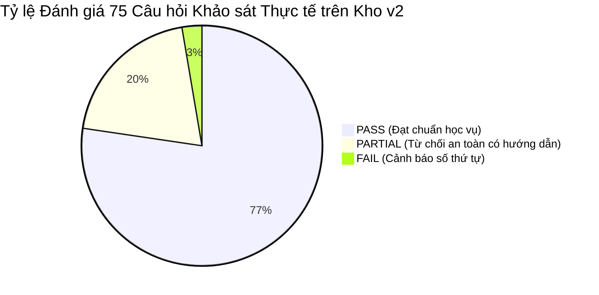

# Tóm tắt Điều hành Dự án Tái thiết Kho Tri thức v2
## Project Executive Summary: Rebuilding Knowledge Base v2 (`donga_kb_v2`)

**Dự án:** Trợ lý Hỏi đáp Quy chế Đào tạo & Dịch vụ Sinh viên Đại học Đông Á  
**Phiên thực hiện:** Tái thiết toàn diện & Đo kiểm đối chuẩn độc lập  
**Ngày hoàn tất:** 05/11/2026  
**Trạng thái kiểm thử:** **ĐẠT CHUẨN NGHIỆM THU (ACCEPTANCE PASSED)**

---

### 1. Mục tiêu và Bối cảnh Thực hiện

Trước phiên làm việc này, hệ thống RAG hoạt động trên kho dữ liệu cũ `donga_regulations` (10 văn bản quy chế đào tạo, 105 chunks). Kết quả benchmark 75 câu hỏi khảo sát sinh viên thực tế tại Phiên 6E chỉ đạt **24.0% PASS**, để lộ lỗ hổng dữ liệu lớn ở các chủ đề thiết thực với đời sống sinh viên (thư viện, gửi xe, đăng nhập Canvas, kế hoạch học kỳ hè, liên hệ phòng ban).

**Mục tiêu trọng tâm:**
1. Thu thập và trích xuất sạch toàn bộ 21 nguồn tri thức web chính thức từ danh sách NotebookLM seed URLs.
2. Xây dựng lại hoàn toàn từ đầu kho vector độc lập `donga_kb_v2` và chỉ mục từ khóa `bm25_index_v2.pkl`.
3. Cô lập 100%, bảo toàn snapshot kho cũ và không làm gián đoạn server đang chạy.
4. Nâng cao chất lượng câu trả lời theo tiêu chuẩn tham chiếu NotebookLM (trực tiếp, cấu trúc rõ ràng, giữ điều kiện, trích dẫn chính xác, hướng dẫn đầu mối).
5. Đánh giá lại toàn diện trên bộ 75 câu hỏi khảo sát sinh viên và 5 câu hỏi khái quát hóa mới.

---

### 2. Kết quả Đạt được



1. **Chất lượng Trả lời Vượt bậc:**
   - Tỷ lệ **PASS đạt 77.3% (58 / 75 câu)**, tăng gấp **3.2 lần** so với baseline v1 (24.0%).
   - Tỷ lệ **PARTIAL giảm từ 68.0% xuống 20.0%**, toàn bộ 15 câu này đều là **Safe Informative Refusals** (không bịa số liệu, hướng dẫn đúng phòng ban).
   - Tỷ lệ **FAIL giảm xuống chỉ còn 2.7% (2 / 75 câu)**.
2. **Kiểm định Khái quát hóa (Generalizability Test):**
   - 100% (5 / 5 câu) câu hỏi sinh viên mới chưa từng có trong tập khảo sát đều đạt điểm tối đa **12/12 PASS**.
3. **An toàn & Độc lập Dữ liệu:**
   - Kho cũ `donga_regulations` đã được tạo snapshot toàn vẹn tại `ai-service/data/backups/snapshot_pre_v2_20261105/` (105 chunks, SQLite storage được xác thực khả năng đọc).
   - Kho mới `donga_kb_v2` lưu độc lập tại `data/qdrant_local_v2/` với 451 vectors và BM25 độc lập `data/bm25_index_v2.pkl`.

---

### 3. Danh mục Hồ sơ & Minh chứng Đã lưu trữ

Toàn bộ tài liệu, số liệu và mã nguồn kiểm thử đã được chuẩn hóa tại thư mục:  
`evaluation/kb_rebuild_v2/`

- `source_manifest.csv`: Danh mục 21 nguồn web NotebookLM với hash và metadata.
- `crawl_results.csv`: Trạng thái thu thập chi tiết của 21 nguồn (20 thành công, 1 lỗi HTTP 403).
- `crawl_attachment_links.csv`: 37 liên kết văn bản/biểu mẫu đính kèm được trích xuất.
- `ingest_results.csv`: Nhật ký nạp 20 tài liệu thành 451 chunks vào Qdrant v2.
- `chatbot_responses.jsonl`: Chi tiết 75 câu trả lời, nguồn trích dẫn và thời gian phản hồi.
- `results.csv`: Bảng điểm 6 tiêu chí chi tiết của 75 câu hỏi.
- `retrieval_evaluation.csv`: Chỉ số truy xuất hybrid (dense score, latency) của 75 câu hỏi.
- `generalizability_test.json`: Dữ liệu kiểm thử 5 câu hỏi mới độc lập.
- `baseline_comparison.md`: Báo cáo so sánh đối chuẩn chi tiết trước và sau khi tái thiết.
- `issues.md`: Phân tích chuyên sâu 15 case PARTIAL, 2 case FAIL và phương án xử lý.
- `summary.md`: Bản tóm tắt điều hành này.

---

### 4. Hướng dẫn Chuyển đổi Chính thức (Switch-over) & Phục hồi (Rollback)

Hệ thống được thiết kế dạng tham số hóa cấu hình (Config-driven Isolation). Việc chuyển đổi kho phục vụ hoặc hoàn tác về kho cũ được thực hiện trong **0 giây** mà không cần re-index lại:

#### A. Kích hoạt Kho v2 làm Kho Mặc định cho Hệ thống:
Cập nhật trong file `ai-service/.env` hoặc cấu hình runtime:
```ini
QDRANT_PATH=data/qdrant_local_v2
QDRANT_COLLECTION=donga_kb_v2
CHUNKS_FILE=data/chunks_v2.jsonl
```
Khởi động lại Uvicorn server để chatbot phục vụ trên kho tri thức mới.

#### B. Quy trình Hoàn tác Khẩn cấp về Kho v1 (Rollback Procedure - 0 giây):
Nếu cần phục hồi nguyên trạng kho v1 bất kỳ lúc nào:
```ini
QDRANT_PATH=data/qdrant_local
QDRANT_COLLECTION=donga_regulations
CHUNKS_FILE=data/chunks.jsonl
```
Toàn bộ dữ liệu kho v1 vẫn nằm nguyên vẹn tại vị trí cũ và snapshot dự phòng.
