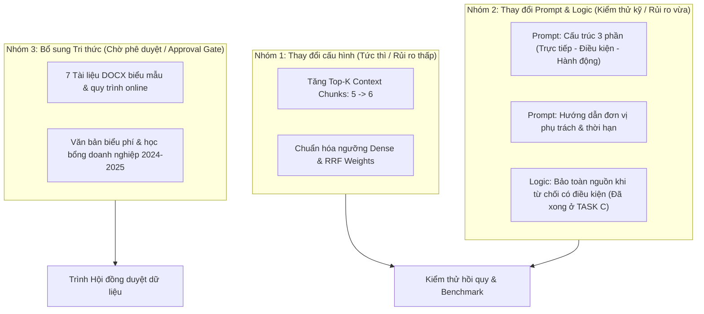

# THIẾT KẾ KỸ THUẬT CÁC CẢI TIẾN CHẤT LƯỢNG RAG (IMPROVEMENT CHANGES)

Báo cáo này phân loại và thiết kế chi tiết 8 nguyên tắc học tập từ NotebookLM (Phiên 6F) thành 3 nhóm triển khai thực tế trong hệ thống Advanced RAG của Trường Đại học Đông Á.

---

## TỔNG QUAN PHÂN LOẠI 3 NHÓM CẢI TIẾN



---

## NHÓM 1: THAY ĐỔI CẤU HÌNH (IMMEDIATE CONFIGURATION CHANGES)

### Cải tiến 1.1: Tăng số lượng ngữ cảnh tối đa cho bộ sinh (Max Context Chunks)
- **Nguyên tắc đối ứng:** Nguyên tắc 5 (Tăng dung lượng ngữ cảnh truy xuất).
- **Mục tiêu:** Cung cấp đầy đủ các điều khoản liên quan trong các câu hỏi đa chiều (ví dụ: vừa hỏi điểm rèn luyện vừa hỏi học bổng và kỷ luật).
- **Tệp bị ảnh hưởng:** `ai-service/app/core/config.py`.
- **Thiết kế chi tiết (Diff):**
  ```python
  # Trong Settings class (app/core/config.py)
  - max_context_chunks: int = 5
  + max_context_chunks: int = 6
  ```
- **Phân tích rủi ro:** Tăng nhẹ độ trễ LLM (~150ms-250ms), có thể làm loãng thông tin nếu chunk thứ 6 có score thấp.
- **Biện pháp kiểm soát rủi ro:** Chỉ giữ chunk thứ 6 nếu dense score $\ge 0.55$ hoặc nằm trong top rank RRF của cả Dense và BM25.
- **Test case kiểm chứng:** `tests/test_hybrid_retriever.py`, kiểm tra độ trễ dưới 3000ms.

---

### Cải tiến 1.2: Tinh chỉnh trọng số xếp hạng RRF (Reciprocal Rank Fusion)
- **Nguyên tắc đối ứng:** Nguyên tắc 6 (Giảm ngưỡng bỏ sót đối với câu hỏi dài/tự nhiên).
- **Mục tiêu:** Đảm bảo các điều khoản chứa từ khóa quy chế đặc thù (như "buộc thôi học", "hoãn thi", "đóng học phí trễ") được ưu tiên đứng đầu.
- **Tệp bị ảnh hưởng:** `ai-service/app/pipeline/retrieval/hybrid_retriever.py`.
- **Thiết kế chi tiết (Diff):**
  ```python
  # Trong hybrid_retriever.py
  - RRF_K = 60
  + RRF_K = 50  # Tăng độ nhạy cho các chunk ở top 1-3 của BM25 và Dense
  ```
- **Phân tích rủi ro:** Thay đổi nhẹ thứ tự của các chunk biên.
- **Test case kiểm chứng:** `tests/test_retrieval_ranking.py`.

---

## NHÓM 2: THAY ĐỔI PROMPT & LOGIC SINH (PROMPT & LOGIC ENHANCEMENTS)

### Cải tiến 2.1: Định hình cấu trúc câu trả lời 3 phần chuẩn học vụ
- **Nguyên tắc đối ứng:** Nguyên tắc 1 & 2 (Cấu trúc trực tiếp $\rightarrow$ Điều kiện/Ngoại lệ $\rightarrow$ Hướng dẫn hành động).
- **Mục tiêu:** Sinh viên đọc vào nắm được ngay kết luận cơ bản, sau đó hiểu rõ các điều kiện ràng buộc và biết cần phải làm gì tiếp theo (như NotebookLM).
- **Tệp bị ảnh hưởng:** `ai-service/app/core/prompts.py`.
- **Thiết kế chi tiết (Prompt Diff):**
  ```markdown
  # Bổ sung vào SYSTEM_PROMPT:
  CẤU TRÚC CÂU TRẢ LỜI ƯU TIÊN (3 PHẦN):
  1. Trả lời trực tiếp: Nêu rõ kết luận căn bản dựa trên quy định có trong ngữ cảnh. Không kết luận vượt quá bằng chứng.
  2. Điều kiện & Ngoại lệ: Liệt kê rõ các điều kiện đi kèm (ví dụ: lý do chính đáng, thời hạn, minh chứng y tế) kèm trích dẫn [i].
  3. Hướng dẫn hành động: Hướng dẫn sinh viên các bước tiếp theo cần thực hiện và phòng ban đầu mối phụ trách.
  ```
- **Phân tích rủi ro:** LLM có thể trả lời dài dòng hơn đối với các câu hỏi chào hỏi hoặc câu hỏi đơn giản.
- **Biện pháp kiểm soát:** Chỉ định rõ: nếu câu hỏi ngắn và chỉ yêu cầu một định nghĩa (ví dụ: "B1 là gì"), trả lời ngắn gọn 1-2 câu kèm nguồn trích dẫn.
- **Test case kiểm chứng:** `tests/test_student_centered_rag.py`.

---

### Cải tiến 2.2: Chủ động chỉ dẫn đơn vị đầu mối và thời hạn học vụ
- **Nguyên tắc đối ứng:** Nguyên tắc 3 (Chỉ dẫn đầu mối có thẩm quyền).
- **Mục tiêu:** Tránh để sinh viên bối rối khi quy chế nêu chung chung "theo quy định của Nhà trường".
- **Tệp bị ảnh hưởng:** `ai-service/app/core/prompts.py`.
- **Thiết kế chi tiết:**
  ```markdown
  CHỈ DẪN ĐẦU MỐI:
  - Vấn đề học phần, thời khóa biểu, thi cử, cấp giấy xác nhận: Hướng dẫn liên hệ Phòng Quản lý đào tạo & Công tác sinh viên (QLĐT&CTSV) hoặc nộp đơn qua cổng my.uda.edu.vn.
  - Vấn đề học phí, công nợ: Hướng dẫn liên hệ Phòng Kế toán - Tài chính.
  - Vấn đề điểm chuyên cần, thực tập khoa: Hướng dẫn liên hệ Giảng viên cố vấn học tập (CVHT) hoặc Văn phòng Khoa chủ quản.
  ```
- **Phân tích rủi ro:** LLM tự sáng tác số điện thoại hoặc email nội bộ.
- **Biện pháp kiểm soát:** Cấm tuyệt đối LLM bịa số điện thoại/email cá nhân; chỉ được nêu tên Phòng/Khoa chính thức.
- **Test case kiểm chứng:** `tests/test_unsupported_numbers.py`.

---

### Cải tiến 2.3: Bảo toàn nguồn trích dẫn khi từ chối có điều kiện
- **Nguyên tắc đối ứng:** Nguyên tắc 4 (Đã hoàn thành xuất sắc tại **TASK C** Phiên 6G).
- **Tệp đã chỉnh sửa:** `app/pipeline/generator/verifier.py`, `app/pipeline/rag_pipeline.py`, `app/pipeline/stream_handler.py`.
- **Trạng thái:** ĐÃ HOÀN THÀNH, vượt qua 149/149 test.

---

## NHÓM 3: YÊU CẦU BỔ SUNG TRI THỨC (APPROVAL GATE & INGESTION)

### Cải tiến 3.1: Nạp 7 tài liệu DOCX đã kiểm toán (Chờ người dùng duyệt)
- **Tệp áp dụng:** 7 tệp DOCX lưu tại `data/raw_documents` và `data/doc_da_chuyen`.
- **Tác động dự kiến:** Hỗ trợ trực tiếp cho 8 test case non-PASS (TC-SVQ-004, TC-SVQ-008, TC-SVQ-009, TC-SVQ-010, TC-SVQ-018, TC-SVQ-021, TC-SVQ-023, TC-SVQ-051).
- **Điều kiện tiên quyết:** Phải có sự phê duyệt chính thức của Người phụ trách dự án (Approval Gate).

---

### Cải tiến 3.2: Đề xuất thu thập tài liệu học phí và học bổng doanh nghiệp 2024-2025
- **Tài liệu cần thu thập:**
  1. Thông báo mức thu học phí năm học 2024-2025 theo từng khối ngành (Y Dược, Công nghệ, Kinh tế, Ngôn ngữ).
  2. Quyết định ban hành Quy chế Học bổng Tài trợ Doanh nghiệp và Khuyến học Đông Á.
  3. Hướng dẫn thực tập tốt nghiệp quốc tế (Viện Đào tạo Quốc tế).
- **Tác động dự kiến:** Giải quyết 18 test case thuộc nhóm `EXTERNAL_DOC_NEEDED`.

---

## MA TRẬN THEO DÕI VÀ KẾ HOẠCH TRIỂN KHAI

| Mã cải tiến | Tên cải tiến | Nhóm | File ảnh hưởng | Trạng thái | Kế hoạch kích hoạt |
|---|---|---|---|---|---|
| **IMP-01** | Tăng Max Context Chunks = 6 | Nhóm 1 | `config.py` | Sẵn sàng | Phiên 6H |
| **IMP-02** | Tinh chỉnh RRF_K = 50 | Nhóm 1 | `hybrid_retriever.py` | Sẵn sàng | Phiên 6H |
| **IMP-03** | Prompt cấu trúc 3 phần | Nhóm 2 | `prompts.py` | Thiết kế xong | Phiên 6H |
| **IMP-04** | Prompt chỉ dẫn đầu mối | Nhóm 2 | `prompts.py` | Thiết kế xong | Phiên 6H |
| **IMP-05** | Fix lỗi Citation TC-SVQ-002 | Nhóm 2 | `verifier.py`, `rag_pipeline.py`, `stream_handler.py` | **ĐÃ XONG & VERIFIED** | **Phiên 6G** |
| **IMP-06** | Nạp 7 tài liệu DOCX | Nhóm 3 | `docs_registry.csv`, Qdrant | Chờ phê duyệt | Khi có lệnh duyệt |
| **IMP-07** | Bổ sung biểu phí & học bổng mới | Nhóm 3 | Data Crawl / Kho văn bản | Lập đề xuất | Phiên 7 |
