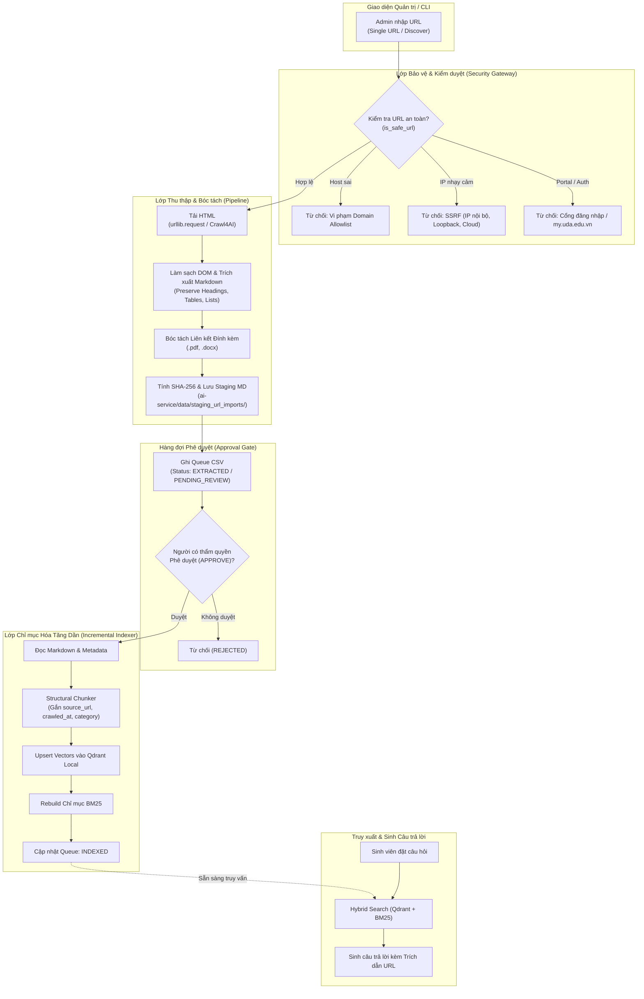

# KIẾN TRÚC HỆ THỐNG NẠP TRI THỨC TỪ URL (NOTEBOOKLM-LIKE KNOWLEDGE IMPORT)

**Dự án:** Trợ lý hỏi đáp quy chế Đại học Đông Á (Advanced RAG)  
**Phiên:** 6H — NotebookLM-Like URL Knowledge Import  
**Ngày hoàn thiện:** 05/11/2026  
**Trạng thái:** Sẵn sàng triển khai thực tế  

---

## 1. BỐI CẢNH VÀ MỤC TIÊU THIẾT KẾ

### 1.1. Vấn đề thực tế
Trong phiên 6F và 6G, khi so sánh đối sánh với Google NotebookLM, nhận thấy NotebookLM vượt trội ở tính tiện dụng: người dùng/quản trị viên chỉ cần dán một đường link URL (trang web, thông báo, quy chế trực tuyến), hệ thống tự động bóc tách nội dung, chỉ mục hóa và cho phép hỏi đáp ngay lập tức kèm trích dẫn chính xác nguồn gốc.

Tại hệ thống RAG nội bộ của Trường Đại học Đông Á, pipeline ban đầu đòi hỏi nạp tài liệu thủ công qua PDF/DOCX hoặc chạy crawler theo lô lớn vào Staging, chưa hỗ trợ nạp tăng dần (incremental) từng đường link đơn lẻ hoặc khám phá phân vùng web có kiểm soát an toàn.

### 1.2. Mục tiêu kiến trúc
Xây dựng module `URLImporter` và quy trình nạp tri thức URL đạt chuẩn an toàn doanh nghiệp (Enterprise Safe):
1. **Trải nghiệm NotebookLM-like:** Nhập 1 URL $\rightarrow$ Tự động tải, làm sạch, bóc tách cấu trúc (Heading, Table, List) $\rightarrow$ Lưu bản ghi Staging $\rightarrow$ Phê duyệt $\rightarrow$ Nạp ngay vào Qdrant & BM25.
2. **Nguyên tắc Safe Ingestion (Default-Deny):** Không tự ý nạp dữ liệu web vào cơ sở dữ liệu chính khi chưa có sự phê duyệt (`APPROVED`) của người có thẩm quyền.
3. **Phòng chống SSRF & Rò rỉ dữ liệu:** Ngăn chặn tuyệt đối tấn công Server-Side Request Forgery vào mạng nội bộ hoặc cloud metadata service, đồng thời chặn thu thập các cổng thông tin cá nhân/sinh viên (`my.uda.edu.vn`, `/login`).
4. **Trích dẫn nguồn cấp độ URL (URL-level Citation):** Lưu giữ `source_url`, `doc_title`, `crawled_at` trong metadata của từng chunk để chatbot sinh trích dẫn và liên kết trực tiếp tới bài viết gốc.

---

## 2. KIẾN TRÚC TỔNG THỂ VÀ LUỒNG DỮ LIỆU

### 2.1. Sơ đồ luồng xử lý (Data Flow Diagram)



---

## 3. CÁC THÀNH PHẦN KỸ THUẬT CỐT LÕI

### 3.1. Hai Chế độ Thu thập Tri thức

#### A. Chế độ Single URL (`import_single_url`)
- **Mục đích:** Nạp nhanh một trang thông báo, giới thiệu, hướng dẫn học vụ cụ thể.
- **Cơ chế:**
  - Xác thực URL qua hàm `is_safe_url`.
  - Fetch nội dung HTML bằng HTTP GET với User-Agent chuẩn của Trường.
  - Chuyển đổi sang Markdown sạch bằng bộ phân tích DOM tùy biến (Custom HTML-to-Markdown parser), giữ cấu trúc bảng HTML (`| col1 | col2 |`), tiêu đề (`#`, `##`), danh sách gạch đầu dòng (`- `).
  - Tự động bóc tách các liên kết tài liệu đính kèm (`.pdf`, `.docx`) để phục vụ kiểm toán tài liệu.
  - Tạo mã định danh duy nhất: `URL-YYYYMMDD-<SHA256[:6]>`.
  - Lưu tệp Markdown tại `ai-service/data/staging_url_imports/<sha256[:16]>.md`.
  - Đăng ký vào hàng đợi `ai-service/data/url_approval_queue.csv` với trạng thái `PENDING_REVIEW` (hoặc `EXTRACTED`).

#### B. Chế độ Website Discovery (`discover_website`)
- **Mục đích:** Quét khám phá các trang thông tin trong một phân vùng website (ví dụ: `https://donga.edu.vn/tuyensinh`).
- **Cơ chế:**
  - Khám phá đệ quy có giới hạn: `max_depth` (mặc định 2), `max_urls` (mặc định 20), `delay_sec` (1.0s giữa các request để chống làm quá tải server trường).
  - Chỉ đi theo các đường link thuộc cùng hostname và domain allowlist.
  - Bỏ qua các đường link dẫn đến file ảnh, video, css, js, và các trang xác thực tài khoản.
  - Tự động đưa toàn bộ các trang thu thập được vào staging và hàng đợi duyệt theo từng hạng mục.

---

### 3.2. Thiết kế An toàn Bảo mật (SSRF & Access Control)

Hàm `is_safe_url` và `is_safe_ip` đảm bảo các rào chắn cứng:
1. **Domain Allowlist:** Chỉ chấp nhận tên miền thuộc Đại học Đông Á (`donga.edu.vn`, `uda.edu.vn`) và các tên miền con hợp lệ (subdomains).
2. **Phòng chống SSRF (Server-Side Request Forgery):**
   - Phân giải DNS của hostname ra địa chỉ IP.
   - Chặn tuyệt đối IP Private (RFC 1918): `10.0.0.0/8`, `172.16.0.0/12`, `192.168.0.0/16`.
   - Chặn IP Loopback: `127.0.0.0/8`, `::1`.
   - Chặn Link-Local: `169.254.0.0/16` (Cloud Metadata AWS/GCP/Azure).
3. **Chống Rò rỉ Thông tin Cá nhân & Cổng Nội bộ:**
   - Chặn cổng thông tin sinh viên cá nhân: `my.uda.edu.vn`.
   - Chặn các đường dẫn nhạy cảm: `/login`, `/admin`, `/dangnhap`, `/auth`, `/user`, `/portal`.
4. **Giao thức & Cổng an toàn:**
   - Chỉ cho phép scheme `http` và `https`.
   - Chỉ cho phép cổng chuẩn `80` và `443`.

---

### 3.3. Bộ Xử lý Làm sạch HTML và Bóc tách Cấu trúc (HTML-to-Markdown)

Một điểm đặc biệt khi bóc tách website của Trường Đại học Đông Á (nền tảng DotNetNuke / ASP.NET WebForms):
- **Đặc thù ASP.NET:** Toàn bộ nội dung trang web nằm bên trong thẻ `<form id="aspnetForm" action="...">`. Nếu bộ bóc tách HTML xóa thẻ `<form>` theo dạng boiler-plate thông thường, toàn bộ nội dung trang sẽ bị mất trắng (`CONTENT_EMPTY`).
- **Giải pháp tối ưu:** Bộ lọc chỉ loại bỏ các thành phần giao diện không mang tri thức (`<script>`, `<style>`, `<nav>`, `<footer>`, `<header>`, `<aside>`, `<noscript>`, `<svg>`, `<iframe>`, `<input>`, `<button>`, `<select>`), nhưng giữ nguyên thẻ container `<form>` để trích xuất tri thức đầy đủ.
- **Xử lý Bảng biểu (Tables):** Các bảng thông tin được chuẩn hóa tự động sang định dạng bảng Markdown với header delimiter `| --- | --- |`, đảm bảo bộ phân đoạn (Structural Chunker) giữ nguyên ngữ cảnh bảng điểm, học phí, lịch trình.

---

### 3.4. Cỗ máy Trạng thái Phê duyệt (Approval State Machine)

Để đảm bảo tuân thủ nguyên tắc **Default-Deny** và tiêu chuẩn NCKH:
- Mọi tri thức web thu thập từ bên ngoài **KHÔNG BAO GIỜ** được tự động nạp thẳng vào Qdrant.
- Hệ thống quản lý trạng thái qua 5 nấc:

| Trạng thái | Ý nghĩa | Hành động tiếp theo |
|---|---|---|
| `DISCOVERED` | URL được phát hiện qua crawler/discovery | Tiến hành fetch nội dung |
| `EXTRACTED` | Đã tải và trích xuất Markdown an toàn vào Staging | Chờ phân loại |
| `PENDING_REVIEW` | Đã kiểm toán sơ bộ, sẵn sàng để người quản trị duyệt | Người quản trị xem nội dung |
| `APPROVED` | Người có thẩm quyền phê duyệt chính thức bằng lệnh `approve` | Sẵn sàng Ingest |
| `INDEXED` | Đã phân đoạn, nhúng vector vào Qdrant và cập nhật BM25 | Chatbot sẵn sàng trả lời |
| `REJECTED` | Từ chối phê duyệt do không liên quan hoặc thông tin cũ | Lưu vết, không nạp |

---

### 3.5. Chỉ mục hóa Tăng dần (Incremental Ingestion)

Quy trình nạp tăng dần qua `incremental_indexer.py`:
1. Chỉ đọc các bản ghi có trạng thái `APPROVED` trong `url_approval_queue.csv`.
2. Kiểm tra tệp Markdown tương ứng trong `data/staging_url_imports/`.
3. Phân loại tài liệu: tự động gắn `category="tai_lieu_tong_hop"` (Tuyệt đối không xếp loại tài liệu web thành `quy_che_truong`).
4. Gọi `index_service.index_document`:
   - Phân đoạn văn bản cấu trúc theo Heading/Điều khoản.
   - Đính kèm metadata mở rộng: `source_url`, `crawled_at`, `content_type="web_page"`.
   - Cập nhật điểm vector vào Qdrant local.
   - Lưu trữ bản ghi vào `chunks.jsonl` và tái lập chỉ mục BM25.
5. Cập nhật trạng thái trong hàng đợi thành `INDEXED` và ghi nhật ký thời gian hoàn tất.

---

## 4. CÔNG CỤ QUẢN TRỊ DÒNG LỆNH (CLI TOOLING)

Hệ thống cung cấp CLI quản trị hoàn chỉnh tại `ai-service/scripts/manage_url_queue.py`:

```bash
# 1. Liệt kê danh sách URL trong hàng đợi
python -m scripts.manage_url_queue list

# 2. Nạp một URL vào Staging và Hàng đợi duyệt
python -m scripts.manage_url_queue import "https://donga.edu.vn/gioi-thieu"

# 3. Phê duyệt một bản ghi (kèm lý do)
python -m scripts.manage_url_queue approve URL-20261105-2B329B --notes "Duyệt trang giới thiệu"

# 4. Từ chối một bản ghi
python -m scripts.manage_url_queue reject URL-20261105-XXXXXX --notes "Thông tin lỗi thời"

# 5. Chạy thử nghiệm nạp (Dry-run không ghi Qdrant)
python -m scripts.manage_url_queue ingest --dry-run

# 6. Nạp chính thức các bản ghi APPROVED vào Qdrant & BM25
python -m scripts.manage_url_queue ingest
```

---

## 5. ĐÁNH GIÁ VÀ KẾT LUẬN KIẾN TRÚC

1. **Tính tương thích:** Tận dụng 100% pipeline hiện có (`index_service`, `structural_chunker`, `retrieval`, `prompts`), không làm thay đổi kiến trúc cốt lõi.
2. **Tính bảo mật:** Cơ chế kiểm tra SSRF và domain allowlist hoạt động độc lập ngay trước khi mở bất kỳ kết nối mạng nào.
3. **Tính mở rộng:** Cho phép dễ dàng kết nối Web UI (FastAPI router) vào các hàm `import_single_url`, `approve_url_in_queue`, `index_approved_urls` để tạo giao diện web giống hệt NotebookLM.
